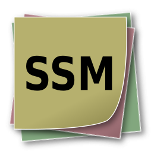
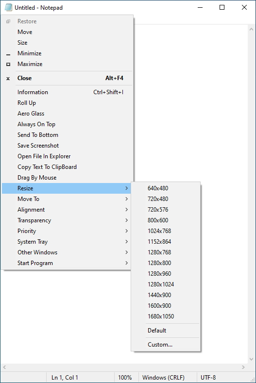
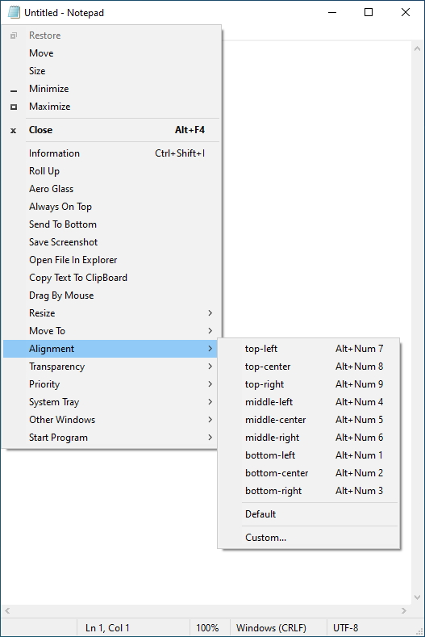
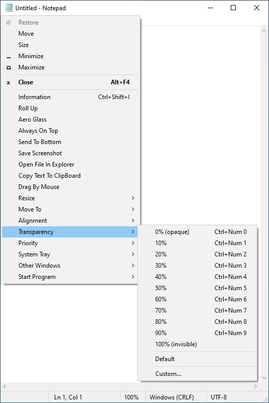
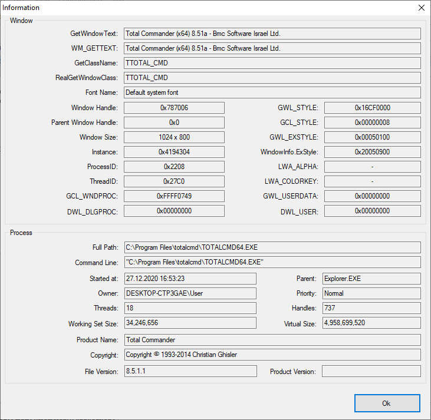

<div align="center">



# SmartSystemMenu (قائمة نظام ذكية)

</div>

🌏: [English](/README.md) [**العربية**](/) [Русский](/README_RU.md) [中文](/README_CN.md) [한국어](/README_KO.md) [Bahasa Indonesia](/README_ID.md)

---

يقوم برنامج **SmartSystemMenu** بتوسيع قائمة النظام الافتراضية لجميع النوافذ في بيئة ويندوز (القائمة التي تظهر عند النقر بزر الماوس الأيمن على شريط العنوان، أو على أيقونة النافذة، أو بالضغط على اختصار `Alt + مفتاح المسافة`).
يضيف البرنامج مجموعة متقدمة من الخصائص والأدوات المفيدة إلى تلك القائمة:

* **معلومات النافذة (Information):** عرض نافذة تحتوي على تفاصيل دقيقة عن النافذة الحالية والعملية التابعة لها (مقبض النافذة Handle، العنوان، الفئة Class، اسم العملية، معرف العملية PID، مسار الملف، وغيرها).
* **إخفاء (Hide):** إخفاء النافذة الحالية مؤقتاً.
* **طي للأعلى (Roll Up):** طي النافذة لتظهر كشريط عنوان فقط لتقليل الفوضى على الشاشة.
* **تأثير شفاف (Aero Glass):** إضافة تأثير التمويه الزجاجي الشفاف إلى النافذة الحالية (ويندوز فيستا وما بعده، مناسب لنوافذ الأوامر).
* **دائمًا في المقدمة (Always On Top):** تثبيت النافذة لتظل دائماً فوق جميع النوافذ الأخرى.
* **إرسال إلى الخلف (Send To Bottom):** إرسال النافذة الحالية إلى خلف كل النوافذ.
* **حفظ لقطة شاشة (Save Screenshot):** حفظ صورة للنافذة المحددة كملف صورة.
* **فتح موقع الملف في المستكشف (Open File In Explorer):** فتح المجلد الذي يحتوي على الملف التنفيذي للنافذة في مستكشف الملفات.
* **سحب بواسطة الماوس (Drag By Mouse):** سحب وتحريك أي نافذة بالنقر والسحب من أي مكان داخلها.
* **النقر عبر النافذة (Click Through):** جعل النافذة شفافة للنقرات بحيث تمر النقرات إلى النوافذ التي تقع خلفها.
* **إخفاء من قائمة Alt+Tab:** إخفاء النافذة من شريط المهام ومن قائمة التبديل السريع Alt+Tab.
* **تغيير الحجم (Resize):** تغيير أبعاد النافذة إلى أحجام محددة مسبقاً أو مخصصة.
* **نقل إلى (Move To):** نقل النافذة مباشرة إلى شاشة أخرى في حالة تعدد الشاشات.
* **محاذاة (Alignment):** محاذاة النافذة بدقة إلى أي من المواضع التسعة على سطح المكتب (أعلى اليمين، الوسط، أسفل اليسار، إلخ).
* **الشفافية (Transparency):** التحكم في درجة شفافية النافذة من 0% حتى 100%.
* **الأولوية (Priority):** تغيير أولوية معالجة البرنامج في المعالج (CPU Priority).
* **الحافظة (Clipboard):** نسخ نصوص النافذة أو لقطة شاشتها أو مسارها بالكامل إلى الحافظة، ومسح الحافظة.
* **تعتيم (Dimmer):** تعتيم كامل الشاشة باستثناء النافذة النشطة لمساعدتك على التركيز.
* **شريط العنوان (Title Bar):** تغيير عنوان النافذة، تغيير أيقونتها، أو تعطيل أزرار (التصغير، التكبير، الإغلاق).
* **علبة النظام (System Tray):** تصغير النافذة أو تعليقها ونقلها إلى صينية النظام بجانب الساعة.
* **النوافذ الأخرى (Other Windows):** تصغير أو إغلاق كافة النوافذ الأخرى ما عدا النافذة الحالية.
* **تشغيل برنامج (Start Program):** تشغيل برامج وأدوات مساعدة محددة مسبقاً في الإعدادات.

---

### لقطات شاشة (Screenshots)






---

### واجهة سطر الأوامر (CLI)

```bash
   --help             عرض المساعدة
   --title            عنوان النافذة
   --titleBegins      العنوان يبدأ بـ
   --titleEnds        العنوان ينتهي بـ
   --titleContains    العنوان يحتوي على
   --handle           مقبض النافذة (1234567890) (0xFFFFFF)
   --processId        معرف العملية PID
-d --delay            تأخير بالمللي ثانية
-l --left             الإزاحة من اليسار
-t --top              الإزاحة من الأعلى
-w --width            العرض
-h --height           الارتفاع
-i --information      عرض نافذة المعلومات
-s --savescreenshot   حفظ لقطة الشاشة
-m --monitor          رقم الشاشة [0, 1, 2, 3, ...]
-a --alignment        المحاذاة [topleft, topcenter, topright, middleleft, middlecenter, middleright, bottomleft, bottomcenter, bottomright, centerhorizontally, centervertically]
-p --priority         الأولوية [realtime, high, abovenormal, normal, belownormal, idle]
   --transparency     الشفافية [0 ... 100]
   --alwaysontop      دائمًا في المقدمة [on, off]
-g --aeroglass        تأثير Aero Glass [on, off]
   --hidealttab       إخفاء من Alt+Tab [on, off]
   --clickthrough     النقر عبر النافذة [on, off]
   --minimizebutton   زر التصغير [on, off]
   --maximizebutton   زر التكبير [on, off]
   --sendtobottom     إرسال إلى الخلف
-o --openinexplorer   فتح موقع الملف في المستكشف
-c --copytoclipboard  نسخ نص النافذة للحافظة
   --copyscreenshot   نسخ لقطة الشاشة للحافظة
   --clearclipboard   مسح الحافظة
   --trustedinstaller تعيين مالك TrustedInstaller لملفات dll
-n --nogui            بدون واجهة رسومية (صامت)

مثال:
SmartSystemMenu.exe --title "Untitled - Notepad" -a topleft -p high --alwaysontop on --nogui
```

---

### التثبيت

* تنزيل حزمة [SmartSystemMenu](https://github.com/AlexanderPro/SmartSystemMenu/releases) بصيغة ZIP.
* عبر [Chocolatey](https://chocolatey.org/): `choco install smartsystemmenu`
* عبر [Scoop](https://scoop.sh/): `scoop bucket add extras` ثم `scoop install extras/smartsystemmenu`
* عبر [WinGet](https://github.com/microsoft/winget-cli): `winget install --id=AlexanderPro.SmartSystemMenu -e`

---

### المتطلبات

* نظام تشغيل Windows XP SP3 أو أحدث (يدعم أنظمة 32-بت و 64-بت).
* حزمة .NET Framework 4.0 أو أحدث.

---

### بنية الملفات

* `SmartSystemMenu.exe`: التطبيق الرئيسي لأنظمة 32-بت.
* `SmartSystemMenu64.exe`: التطبيق المخصص لعمليات 64-بت (مدمج في موارد البرنامج).
* `SmartSystemMenuHook.dll`: خطاف العمليات 32-بت.
* `SmartSystemMenuHook64.dll`: خطاف العمليات 64-بت.
* `SmartSystemMenu.xml`: ملف الإعدادات المخصصة.
* `Language.xml`: ملف الترجمات واللغات (يدعم العربية).
